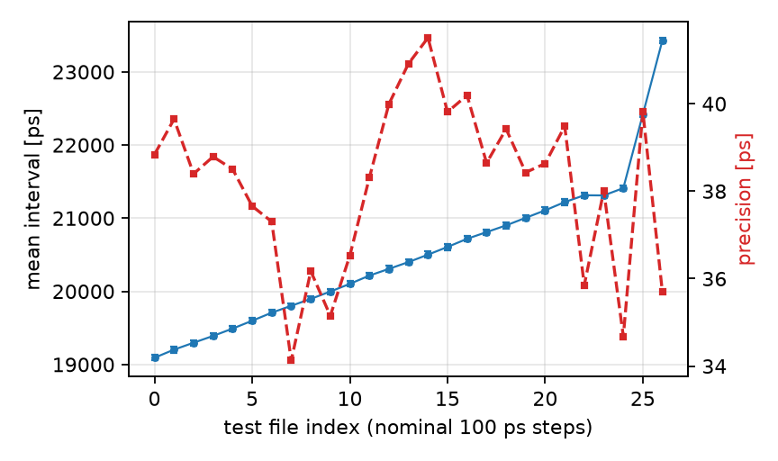
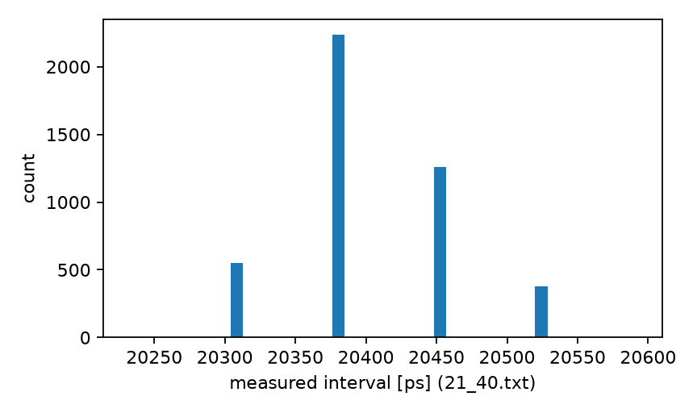

# TDC-Bench — CARRY4 delay-chain TDC measurement & characterization

**TDC-Bench** is the time-interval measurement subsystem of a lab
instrument-development effort (working name). This release contains its
characterization subset: the FPGA measurement-chain RTL, the acquisition
analysis tooling, and the raw characterization datasets. The remaining
subsystems of the parent project are not part of this release.

Hardware: a quantization-delay **time-to-digital converter** on Xilinx
Artix-7 (XC7A35T) — a tapped delay line built from CARRY4 carry primitives,
a latch-to-binary encoder, and coarse–fine counting.

## Repository layout

```
rtl/
  tdc_top.v      top level: STAGE=200 delay-line stages, GAP_BITS=8 coarse counter,
                 BUFR/BUFG clocking, start-stop sequencing
  line_tdc.v     the CARRY4 tapped delay line (generate-chained primitives)
  latch2bin.v    latch array (2^GAP_BITS) -> binary encoder
analysis/
  tdc_analysis.py              Python analysis: frame decoding + statistics
  test_tdc_carry4_original.m   original MATLAB analysis flow (unmodified)
  measurement_data/            27 raw acquisition files (~4.4k-5.2k measurements
                               each), nominal input intervals in 100 ps steps
results/                       generated: precision table + figures
```

## Measured results (reproducible from the included data)

| Metric | Value | Source |
|---|---|---|
| Bin width (LSB) | **72 ps** | conversion constant in the analysis flow (`50 × 72 ps = 3.6 ns` coarse unit) |
| Single-shot precision | **median 38.5 ps** (34.1–41.5 across 27 files) | `std(delay)/sqrt(2)` per file; the Python port reproduces the original flow |
| Interval tracking | mean measured interval follows the 100 ps nominal steps linearly (constant offset) | `results/interval_tracking.png` |




Reproduce:

```bash
python analysis/tdc_analysis.py --data-dir analysis/measurement_data
```

## Scope & release notes

- The design targeted a 50 ps bin on this device class; the measured bin on
  the XC7A35T is 72 ps (higher-end Artix/Virtex parts reach ~49 ps in
  simulation on the same RTL).
- This release is the **standalone characterization subset**: multi-channel
  extensions, Wave-Union variants and board-integration details of the parent
  project are intentionally excluded.
- Raw measurement frames are included so every published number can be
  regenerated from the data with the included analysis tooling.

## Future work

- Automated on-board calibration scripts (direct ILA capture ingestion);
- multi-channel and Wave-Union extensions of the delay line, if released from
  the parent project;
- temperature/characterisation sweeps across supply and process corners.
